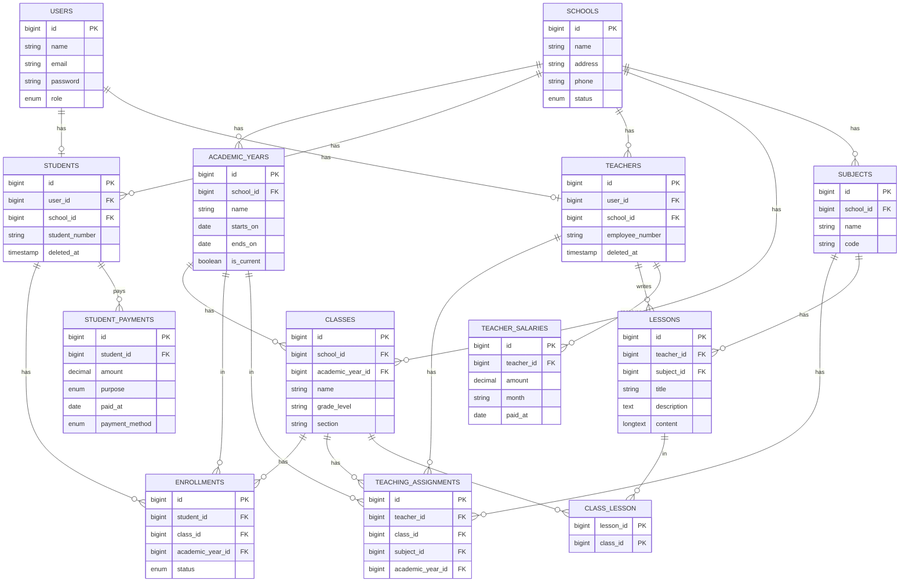

# School Management API: Database Schema (ERD)

> Give this file to the AI coding tool (Cursor) as the source of truth for the database design.

## Project rules
- Stack: Laravel API (Breeze + Sanctum already installed), **MySQL** (not SQLite).
- Keep everything **simple, clear, and easy to modify later**. The developer is a beginner.
- **Do NOT add**: caching, queues, jobs, events/listeners, rate limiting, repositories, service layers, DTOs, or other advanced patterns. Ask first if you think something is needed.
- No migrations have been run yet, so the plan can be changed freely.
- `users` already exists: add the `role` column with a NEW migration.
- Work one phase at a time; explain each phase in simple language; stop and wait for approval.

## Tables (13)
users, schools, academic_years, students, teachers, classes (model `SchoolClass`), subjects, lessons, class_lesson (pivot), enrollments, teaching_assignments, teacher_salaries, student_payments.

Not included on purpose: fees, attendance, assignments, submissions, grades (may be added later, one at a time, only if requested).

## ERD (Mermaid)

## Field details
All tables also have `created_at` / `updated_at` (`timestamps()`), except `class_lesson`. All foreign keys are indexed. Money is `decimal(10,2)`.

| Table | Notes |
|---|---|
| users | `role` enum: admin, teacher, student, staff (default staff); `email` unique |
| schools | `address`, `phone` nullable; `status` enum: active, inactive |
| academic_years | only one `is_current = true` per school (enforce in Form Request) |
| students | `user_id` unique (1:1 with users); unique (`school_id`, `student_number`); softDeletes |
| teachers | `user_id` unique (1:1 with users); unique (`school_id`, `employee_number`); softDeletes |
| classes | model `SchoolClass` (`Class` is a reserved word in PHP); `section` nullable; unique (`school_id`, `academic_year_id`, `name`, `section`) |
| subjects | unique (`school_id`, `code`) |
| lessons | `description`, `content` nullable |
| class_lesson | composite primary key (`lesson_id`, `class_id`), no `id`, no timestamps |
| enrollments | `status` enum: active, completed, withdrawn; unique (`student_id`, `class_id`, `academic_year_id`); no delete endpoint (history) |
| teaching_assignments | unique (`teacher_id`, `class_id`, `subject_id`, `academic_year_id`) |
| teacher_salaries | `month` string like `2026-09`; unique (`teacher_id`, `month`); no delete endpoint |
| student_payments | `purpose` enum: tuition, transport, books, uniform, other; `payment_method` enum: cash, bank_transfer, card; no delete endpoint |

## Relationships
- 1:1: users to students, users to teachers.
- 1:M: schools to (academic_years, students, teachers, classes, subjects); academic_years to classes; teachers to (lessons, teacher_salaries); subjects to lessons; students to student_payments.
- M:M: students and classes via `enrollments`; teachers, classes and subjects via `teaching_assignments`; lessons and classes via `class_lesson`.

## Suggested phases (one at a time)
1. users `role` migration, schools, students, teachers (models, factories, seeder with first admin, policies, basic Pest tests).
2. academic_years, classes, subjects, enrollments, teaching_assignments.
3. lessons and class_lesson.
4. teacher_salaries and student_payments (simple records: no balance logic).
